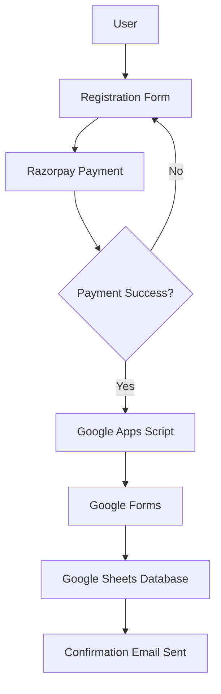

<div align="center">

# 🎟️ Event Management System

**A modern, automated event registration and management platform** — from participant sign-up to payment verification and instant email confirmations.

[](https://opensource.org/licenses/MIT)
[](https://developer.mozilla.org/en-US/docs/Web/HTML)
[](https://developer.mozilla.org/en-US/docs/Web/CSS)
[](https://developer.mozilla.org/en-US/docs/Web/JavaScript)
[](https://developers.google.com/apps-script)
[](https://razorpay.com/)
[](https://pages.github.com/)
[](http://makeapullrequest.com)

*Built for student clubs, college events, workshops, concerts, and community gatherings.*

</div>

---

## 📖 Overview

Event Management System is a lightweight, low-cost event registration platform that automates the entire attendee journey — registration, payment collection, data storage, and confirmation — using a simple stack of static web technologies and Google Workspace automation. No backend server required.

---

## ✨ Features

| | |
|---|---|
| 📝 **Online Event Registration** | Simple, responsive registration form for attendees |
| 💳 **Razorpay Integration** | Secure, reliable payment processing |
| 📧 **Automatic Confirmation Emails** | Instant email confirmation after successful payment |
| 📊 **Google Sheets Database** | Centralized, real-time registration records |
| ⚡ **Google Apps Script Automation** | Zero-server backend logic |
| 📱 **Responsive UI** | Works seamlessly across devices |
| 🎫 **Ticket Registration** | Streamlined ticketing flow |
| 🔒 **Payment Verification** | Ensures only successful transactions are recorded |
| 📈 **Real-time Tracking** | Organizers can monitor sign-ups live |
| 🌐 **GitHub Pages Deployment** | Free, fast, and simple hosting |

---

## 🛠️ Tech Stack

<table>
<tr>
<td valign="top" width="25%">

**Frontend**
- HTML5
- CSS3
- JavaScript

</td>
<td valign="top" width="25%">

**Backend Services**
- Google Apps Script
- Google Forms
- Google Sheets

</td>
<td valign="top" width="25%">

**Payments**
- Razorpay Payment Gateway

</td>
<td valign="top" width="25%">

**Deployment**
- GitHub Pages

</td>
</tr>
</table>

---

## 🔄 System Workflow



---

## 🚀 How It Works

1. **User** opens the event website.
2. **Fills out** the registration form.
3. **Completes payment** securely through Razorpay.
4. Registration details are **verified and stored**.
5. **Google Apps Script** processes the submission.
6. A **confirmation email** is automatically sent to the attendee.
7. **Organizers** monitor registrations live via Google Sheets.

---

## 📂 Project Structure

```
event_management_system/
│
├── index.html          # Main registration page
├── style.css            # Styling and layout
├── script.js             # Client-side logic & Razorpay integration
├── assets/               # Static assets
├── images/               # Image resources
├── README.md
└── LICENSE
```

---

## ⚙️ Getting Started

### Prerequisites
- A [Razorpay](https://razorpay.com/) account and API keys
- A Google account (for Google Sheets & Apps Script)
- Basic familiarity with Google Apps Script deployment

### Setup

```bash
# Clone the repository
git clone https://github.com/angelinamoses/event_management_system.git
cd event_management_system
```

1. Configure your Razorpay API key in `script.js`.
2. Set up a Google Sheet and connect it via Google Apps Script.
3. Deploy the Apps Script as a web app to handle form submissions and emails.
4. Update the Apps Script endpoint URL in `script.js`.
5. Deploy the site using **GitHub Pages** (Settings → Pages → select branch).

---

## 🎯 Use Cases

- 🎓 College Events
- 🎵 Music Concerts
- 🛠️ Workshops
- 📚 Seminars
- 🏢 Conferences
- 🤝 Community Events
- 👥 Club Registrations

---

## 📌 Key Highlights

- ✅ Fully automated registration workflow
- ✅ No manual attendee management
- ✅ Instant confirmation emails
- ✅ Secure online payment collection
- ✅ Easy deployment using GitHub Pages
- ✅ Low-cost implementation using Google Workspace tools

---

## 🔮 Roadmap

- [ ] Admin Dashboard
- [ ] QR Code Ticket Generation
- [ ] Check-in System
- [ ] Attendance Tracking
- [ ] Analytics Dashboard
- [ ] Event Capacity Management
- [ ] SMS Notifications
- [ ] Multi-event Support
- [ ] User Authentication
- [ ] PDF Ticket Generation

---

## 🤝 Contributing

Contributions, issues, and feature requests are welcome!
Feel free to check the [issues page](https://github.com/angelinamoses/event_management_system/issues) or submit a pull request.

1. Fork the project
2. Create your feature branch (`git checkout -b feature/AmazingFeature`)
3. Commit your changes (`git commit -m 'Add some AmazingFeature'`)
4. Push to the branch (`git push origin feature/AmazingFeature`)
5. Open a Pull Request

---

## 👩‍💻 Author

<div align="center">

**Angelina Moses**
*M.Sc. Health Informatics & Analytics*

Interested in: Health Informatics · AI in Healthcare · Machine Learning · Automation · Full Stack Development

[](https://github.com/angelinamoses)

</div>

---

## 📄 License

This project is licensed under the **MIT License** — see the [LICENSE](LICENSE) file for details.

---

<div align="center">

⭐ **If you find this project useful, consider giving it a star!** ⭐

</div>
